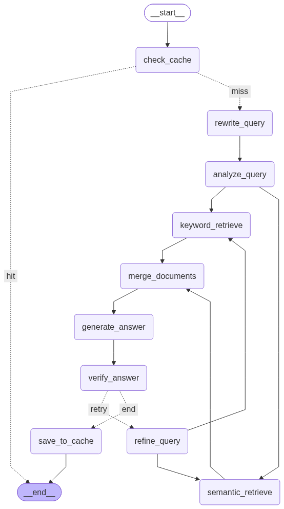

# Project Repository RAG

A Hybrid RAG application for asking questions about `Document/Dataset_project_repository.pdf`, a repository of 100 real-world projects (P001–P100).

It uses **FAISS + BM25** retrieval, a **query rewriter**, **Groq** for generation, a **controlled LangGraph workflow** with answer verification and at most one retry, an **answer cache**, **SQLite** for structured project metadata, a **golden-dataset evaluation** (faithfulness, correctness, precision, recall, F1), **LangSmith** for tracing and **Streamlit** for the UI.

---

## 1. Architecture

The system has three parts: build once, answer questions, and measure quality.

```
OFFLINE (run once)                       ONLINE (every question)                      EVALUATION (on demand)
python ingestion/build_index.py          streamlit run ui/app.py                      python evaluation/build_golden_dataset.py
                                                                                       python evaluation/run_evaluation.py
PDF                                      Streamlit
 ↓ PyPDFLoader                            ↓                                            golden_dataset.json (23 questions,
group pages into projects (P001..P100)   LangGraph                                     answers taken from SQLite)
 ↓                                        ↓ check_cache ── hit ──→ END                  ↓
extract project metadata                  ↓ miss                                       run each question (cache off)
 ↓                                        ↓ rewrite_query       (query rewriter)        ↓
split each project page into a chunk      ↓ analyze_query       (conditions)           score: faithfulness, correctness,
 ↓ chunks inherit project metadata        ↓ semantic_retrieve (FAISS) ∥ keyword_retrieve (BM25)    precision, recall, F1
local embeddings (all-MiniLM-L6-v2)       ↓ merge_documents                             ↓
 ↓                                        ↓ generate_answer     (Groq)                  evaluation/results/
FAISS  +  BM25  +  SQLite  → data/        ↓ verify_answer       (Groq, structured)
                                          ↓ invalid → refine_query → retrieve again (max 1 retry)
                                          ↓ save_to_cache → END
```

The online LangGraph workflow (generated with `build_graph().get_graph().draw_mermaid_png()`):



## 2. Why the PDF is parsed project by project

The PDF is not free text. Page 1 is a cover page. Each project then fills **exactly two pages**:

| Page | Content |
|---|---|
| Summary page | `P038 Data Mesh Implementation for Telco Data Engineering`, Problem Statement, Solution Approach, **Project Details** (Domain, Team Size, Duration, Type), Technology Stack, Expected Outcomes |
| Technical Deep Dive page | Full Technology Breakdown, Key Metrics & Business Impact, Problem Context |

Splitting the whole PDF blindly would produce chunks that start halfway through a project and contain no project ID. That caused the old `project_id = "UNKNOWN"` problem. This project uses the following order instead:

```
pages → group by project ID (page header) → extract metadata from the summary page
      → split that project's pages → every chunk inherits the same metadata
```

If metadata extraction fails for a project, ingestion logs it, does not index that project and never creates `UNKNOWN`.

## 3. Metadata: what we store and why

**Basis:** the metadata is exactly the **PROJECT DETAILS block that every project's summary page has** (the same fields, in the same layout, for all 100 projects), plus the fields needed to **cite sources** and **run retrieval**. We chose fields that users actually ask and filter by: *"team size at least 5"*, *"Data Engineering projects"*, *"uses Snowflake"*, *"longer than 3 months"*. Nothing is guessed or generated: every value is read from the PDF with fixed patterns, and a project with a missing field is reported and skipped.

**Project-level metadata** (`extract_project_metadata()` in `ingestion/metadata_extractor.py`, one row per project in SQLite):

| Field | Example | Read from | Used for |
|---|---|---|---|
| `project_id` | `P038` | first line of the summary page | identifying and citing the project; BM25 matches exact IDs |
| `project_name` | `Data Mesh Implementation for Telco` | first line, ID and type removed | showing and citing the project |
| `type` | `Data Engineering` | `Type ...` in Project Details | type filter (only 3 types: ML/AI 44, NLP / GenAI 34, Data Engineering 22) |
| `domain` | `Telecom / Data Platform` | `Domain ...` | shown in answers and sources |
| `team_size` | `10` (integer) | `Team Size 10 people` | numeric filter (`>=`, `<`, ...) |
| `duration` | `9 months` | `Duration 9 months` | shown to the user, exactly as written |
| `duration_weeks` | `39.0` | computed: months × 52/12 | numeric filter, so `10 weeks` and `3 months` can be compared |
| `technology_stack` | `["GCP Dataplex", "BigQuery", ...]` | Technology Stack section, split on `·` | technology filter (all / any), typo-tolerant name matching |
| `pages` | `[75, 76]` | page numbers | citations |

**Chunk-level metadata** (added in `ingestion/text_splitter.py`, on every chunk):

| Field | Example | Used for |
|---|---|---|
| `page` | `75` | showing the source page |
| `section` | `summary` / `technical_deep_dive` | filtered retrieval searches only `summary` chunks, which hold every field |
| `chunk_id` | `P038-p75-c0` | removing duplicates when FAISS and BM25 return the same chunk |
| `retrieval_method` | `semantic` / `keyword` / `both` | added at query time in `merge_documents`; shown in the Sources table |

Metadata is read only from the **summary page**. The deep-dive page drops units (`9` above `Duration` instead of `9 months`) and sometimes splits words (`T ool`).

## 4. Chunking strategy

**Structure-based chunking: one chunk per project page.**

1. **Group by project first** (`group_pages_by_project()`), so a chunk never mixes two projects.
2. **Split each page on its own**: page 1 becomes the `summary` chunk, page 2 the `technical_deep_dive` chunk. Each chunk keeps its exact page number.
3. **RecursiveCharacterTextSplitter (1000 characters, 100 overlap)** is applied to each page. It cuts at paragraph, then line, then word boundaries.
4. **A header is added to every chunk**: `Project P038: Data Mesh ... | Type ... | Team Size ... | Duration ...`, so even the deep-dive chunk names its project for FAISS and BM25.
5. **Every chunk inherits the project's metadata** (section 3).

Measured on this PDF:

| | Min | Average | Max |
|---|---|---|---|
| Summary page text | 618 | 702 | 764 characters |
| Deep-dive page text | 418 | 483 | 533 characters |
| Chunk incl. header | 551 | 734 | 918 characters |

Every page is shorter than 1000 characters, so **each page becomes exactly one chunk: 100 projects → 200 chunks**, and the 100-character overlap is never needed. The size limit is only a safety net in case a longer page is added later.

**Why this strategy:** each project page is already one complete, self-contained unit about one project, so splitting it smaller would separate facts that belong together (e.g. a project's tech stack from its name). One chunk per page keeps every fact next to its project ID, keeps answers small enough for Groq's token limit, and lets filtered questions use exactly one `summary` chunk per project.

## 5. Why both FAISS and BM25

| | FAISS (semantic) | BM25 (keyword) |
|---|---|---|
| Matches by | meaning (embeddings) | exact terms |
| Good for | different wording from the PDF ("cut customer attrition" → churn project) | `P038`, `Snowflake`, `Kafka`, `team size`, `Data Engineering` |
| Weak at | exact IDs and rare product names | synonyms and paraphrases |

Real example from testing: for *"What is the team size and duration of P057?"*, FAISS returned five unrelated projects, and **only BM25 found P057**. Hybrid retrieval combines both strengths. `merge_documents` removes duplicate chunks and tags each one `semantic`, `keyword` or `both`. Chunks found by both retrievers are listed first. No extra reranker is used.

## 6. Why SQLite is separate from retrieval

SQLite (`data/project.db`, table `projects`) stores **one clean row per project**. It is **not** a third retriever. It has two uses:

1. **Inspection**: browse the whole repository with the SQLite VS Code extension.
2. **Deterministic filtering**: questions like *"team size less than 5 and duration less than 3 months"* need exact comparisons and the **complete** list of matches, not the top few similar chunks.

The work is split between understanding the question and comparing numbers:
- **Understanding (LLM):** the `analyze_query` LLM call fills a fixed Pydantic schema (`QueryAnalysis` in `graph/metadata_filters.py`) with the conditions in the question: team size, duration, project type and technologies. Because an LLM reads the question, typos and informal wording still work: *"atleast 5 members"*, *"more then 3 months"*, *"5+ ppl"*, *"half a year"*, *"pythn and langchian"*.
- **Validation (Python):** `build_metadata_filters()` converts durations to weeks, maps technology names onto the names used in the PDF (with fuzzy matching for misspellings), and skips filters when the question names a specific project ID.
- **Comparison (Python):** `filter_projects_by_metadata()` compares the conditions against the exact values from SQLite. The LLM never decides which projects match.
- **Filtered retrieval:** when a question has conditions, FAISS and BM25 search **only the summary chunks of the matching projects** (up to 8). Without this, a question like *"solution approach of projects using Python and AWS with team size > 3"* retrieved chunks from unrelated projects, and the answer was "I don't know".

Example: `team size < 5 and duration < 3 months` returns 35 projects. **P051** (2 people, 5 weeks) and **P088** (2 people, 5 weeks) are included. **P058** (3 people, 3 months) is excluded, because 3 months is not *less than* 3 months.

The complete match list goes into the prompt as an authoritative block (with an exact technology tally), so the LLM never does numeric reasoning. FAISS and BM25 supply the descriptive text.

Filters are skipped when a question names a specific project (e.g. "Does P038 use Python?"), because that question is about that project.

## 7. Query rewriter

`rewrite_query` (in `graph/nodes.py`, prompt `REWRITE_QUERY_PROMPT` in `graph/prompts.py`) is the first LLM step. It turns the user's question into a short, clean search query for FAISS and BM25:

| User question | Rewritten search query |
|---|---|
| `wht technolgies r usd in p038` | `technology stack P038` |
| `solution aproach of P090` | `solution approach P090` |
| `Which NLP / GenAI projects have a team size of at least 5?` | `NLP or generative AI projects with team size at least 5` |
| `what is the weather in delhi today` | unchanged (off-topic questions are not rewritten) |

It fixes spelling, expands abbreviations (`ppl` → `people`), keeps every project ID, number and unit, and adds only the field names the question asks about. `keep_project_ids()` then guarantees that no project ID is lost in the rewrite.

There are two query-rewriting steps:
- `rewrite_query`: **before** the first search, from the user's question.
- `refine_query`: **only on a retry**, using the verifier's feedback about what was missing.

`analyze_query` runs after the rewriter and only extracts the conditions (section 6), reading the original question so no condition is lost.

## 8. Caching

There are two levels of caching:

| Level | What is cached | Where | Effect |
|---|---|---|---|
| **Resource cache** | FAISS index, BM25 retriever, project metadata, technology names, the Groq client, the compiled graph | `@lru_cache` in `graph/nodes.py` and `graph/llm.py`, `@st.cache_resource` in `ui/app.py` | loaded from disk once per process, never per question |
| **Answer cache** | the full result of a question that **passed verification** | `data/answer_cache.db` (SQLite), `graph/answer_cache.py` | asking the same question again skips every LLM call |

How the answer cache works in the graph:
- `check_cache` (first node) turns the question into a **cache key** with `normalize_question()` and looks it up. On a **hit**, the cached answer goes straight to `END` and the UI shows *"⚡ Answered from the answer cache"*.
- `save_to_cache` (last node) stores the answer, but **only if `is_valid` is True**, so a wrong answer is never cached.
- **Cache key = the question's meaningful words, in order, lowercase.** Punctuation and filler words (*tell, me, about, please, what, is, the, ...*) are dropped; project IDs, numbers, technologies, *more / less*, *not*, *and / or*, *how many* and `< > =` are kept:

  | Question | Cache key |
  |---|---|
  | `tell me about project P098` | `project p098` |
  | `Tell about project P098?` | `project p098` (same key → cache hit) |
  | `tell me about project P089` | `project p089` (different project → miss) |
  | `team size < 5` / `team size > 5` | different keys |

- There is deliberately **no "similar meaning" (embedding) cache**: *P098* and *P089* look almost identical to an embedding model but are different projects, so a meaning-based cache could return the wrong project's answer.
- The cache is cleared by `python ingestion/build_index.py --rebuild` and by the **Clear answer cache** button in the UI sidebar, so it never outlives the indexes it was built from. The evaluation runs with `use_cache=False`.

## 9. Why indexing is offline and runs only once

Parsing the PDF and computing embeddings on every question (or on every Streamlit rerun) would be slow and wasteful. `build_index.py` is the **only** code that builds anything:

- If `data/` already holds indexes, it stops and tells you to use `--rebuild`.
- `ui/app.py` only **loads** `data/faiss_index/`, `data/bm25.pkl` and `data/project.db`, using the resource cache (section 8).

## 10. Verification and controlled retry

```
generate_answer → verify_answer ─ valid ───────────────────────────────────────→ save_to_cache → END
                                └ invalid → check_verification
                                              ├ retry_count < 1 → refine_query → FAISS ∥ BM25 → merge → generate → verify → ...
                                              └ retry used up   → save_to_cache (skips invalid answers) → END
```

- `verify_answer` does **not** write a new answer. It returns `is_valid` and `verification_feedback` using structured output (a Pydantic model). It checks grounding, project IDs, names, team sizes, durations and technologies, hallucinations, whether all filter candidates were covered, and whether the question was actually answered.
- `refine_query` uses the original question, the previous search query and the verifier feedback to write a better retrieval query, and sets `retry_count = 1`.
- `check_verification` allows **at most one retry** (`MAX_RETRIES = 1` in `graph/routing.py`), so the graph cannot loop. If the answer still fails, the UI shows it with a warning.

LLM calls per question: `rewrite_query`, `analyze_query`, `generate_answer` and `verify_answer` (4 total), plus `refine_query` and one more generate/verify only on a retry, and **0** on a cache hit. Retrieval, merging, filtering and caching never call the LLM.

**Off-topic questions** (weather, news, general knowledge, coding help, ...) are handled by the answer prompt, with no extra node. `generate_answer` replies with a fixed message: *"This question is not related to the project repository, so I can't answer it..."*. `verify_answer` accepts that reply only when the question really is off-topic, and the UI hides the Sources table for it.

`analyze_query` and `verify_answer` use Groq's **strict JSON-schema** structured output through `invoke_structured()`. If the model replies with plain text instead of JSON (HTTP 400 `output_parse_failed`), the call is repeated once in JSON mode with the schema written into the prompt.

## 11. Evaluation

The evaluation answers *"how good are the answers?"* with numbers, using a **golden dataset** (an answer key) and five metrics.

### Golden dataset

`evaluation/golden_dataset.json` holds **23 questions with known correct answers**, built by `evaluation/build_golden_dataset.py`. Every correct answer is taken **directly from `data/project.db` with plain SQL**, never from the RAG pipeline, so the answer key is independent of the system being tested.

| Category | Questions | Example |
|---|---|---|
| `fact_lookup` | 5 | What is the team size and duration of P057? |
| `technology_stack` | 3 | What technologies are used in P038? |
| `section_lookup` | 3 | What is the solution approach of P090? (reference = the PDF section) |
| `semantic_search` | 3 | Which project built a chatbot that answers employee questions about HR policies? (→ P011) |
| `metadata_filter` | 5 | Which projects have a team size less than 5 and a duration less than 3 months? (→ 35 projects) |
| `typo_filter` | 1 | which projcts use pythn and snowflak (tests the query rewriter) |
| `out_of_scope` | 2 | What is the weather in Delhi today? (→ fixed refusal) |
| `not_in_documents` | 1 | Who was the project manager of P038? (→ "I don't know") |

### Metrics

| Metric | Question it answers | How it is computed |
|---|---|---|
| **Faithfulness** | Is the answer supported by the retrieved context (no hallucination)? | LLM judge splits the answer into claims; score = supported claims / total claims |
| **Correctness** | Is the answer the right answer? | LLM judge compares the answer with the golden reference: correct = 1, partially correct = 0.5, incorrect = 0. Fixed replies (off-topic, "I don't know") are checked by exact match |
| **Precision** | Did the answer mention wrong projects? | project IDs in the answer that are expected / all project IDs in the answer |
| **Recall** | Did the answer miss projects? | expected project IDs found in the answer / all expected project IDs |
| **F1** | One number for precision and recall | 2 × precision × recall / (precision + recall) |

**Precision, recall and F1 apply to questions whose answer is a set of projects**: `semantic_search`, `metadata_filter`, `typo_filter`, and the `out_of_scope` / `not_in_documents` questions, where the correct set is empty. A question that already names its project (*"team size of P057?"*) is answered without repeating the ID, so for those, correctness and faithfulness are the measures. Shown as `-` where a metric does not apply.

Also reported: **context precision / recall** (the same formula on the projects the LLM was given, which measures retrieval), **latency**, the share of answers that passed verification, and the retry rate. Precision, recall and F1 are deterministic (no LLM); faithfulness and correctness use the same Groq model as a judge (`evaluation/judge_prompts.py`).

### Run it

```bash
python evaluation/build_golden_dataset.py          # (re)create golden_dataset.json from data/project.db
python evaluation/run_evaluation.py                # all 23 questions, answer cache off
python evaluation/run_evaluation.py --limit 5      # first 5 only
python evaluation/run_evaluation.py --ids Q01,Q15  # selected questions
python evaluation/run_evaluation.py --rerun-errors # re-run only questions that failed (e.g. rate limit)
```

Results go to `evaluation/results/evaluation_results.csv` (one row per question, with the answer and the judges' reasons) and `evaluation/results/evaluation_summary.json` (averages overall and per category). On the Groq free tier a full run takes 15–20 minutes because of the tokens-per-minute limit, and the free tier also allows only **200,000 tokens per day**. A question that fails with HTTP 429 is recorded as an error and excluded from the averages; `--rerun-errors` re-runs just those questions later and merges them into the results.

### Latest results

**All 23 questions scored, 0 errors (2026-10-11, current code).** Full per-question details are in `evaluation/results/evaluation_results.csv`.

| Category | Questions | Faithfulness | Correctness | Precision | Recall | F1 | Context precision | Context recall |
|---|---|---|---|---|---|---|---|---|
| fact_lookup | 5 | 1.00 | 1.00 | - | - | - | 0.12 | 1.00 |
| technology_stack | 3 | 1.00 | 1.00 | - | - | - | 0.13 | 1.00 |
| section_lookup | 3 | 1.00 | 1.00 | - | - | - | 0.13 | 1.00 |
| semantic_search | 3 | 1.00 | 1.00 | 1.00 | 1.00 | 1.00 | 0.18 | 1.00 |
| metadata_filter | 5 | 1.00 | 1.00 | 1.00 | 1.00 | 1.00 | 1.00 | 1.00 |
| typo_filter | 1 | 1.00 | 1.00 | 1.00 | 1.00 | 1.00 | 1.00 | 1.00 |
| out_of_scope | 2 | 1.00 | 1.00 | 1.00 | 1.00 | 1.00 | - | - |
| not_in_documents | 1 | 1.00 | 1.00 | 1.00 | 1.00 | 1.00 | - | - |
| **Overall** | **23** | **1.00** | **1.00** | **1.00** | **1.00** | **1.00** | 0.40 | 1.00 |

- **Verified:** 23 / 23 answers passed `verify_answer`, none needed a retry. Average latency 39 s per question (mostly free-tier rate-limit waits).
- **Filter questions:** every list was exact, e.g. *team size < 5 and duration < 3 months* → all **35** projects, none extra; *Python and Snowflake* → **17**; the typo version *"which projcts use pythn and snowflak"* → the same 17 (query rewriter + typo-tolerant filters).
- **Context precision** is low for single-project questions (≈ 0.13) by design: the top-5 FAISS + top-5 BM25 chunks come from several projects and only one of them is the expected project. **Context recall of 1.00** means the expected project was always in what the LLM saw.
- **Reading the 1.00 scores honestly:** the golden dataset is small (23 questions), and faithfulness / correctness are judged by the same Groq model that answers, so these scores can be slightly generous. Precision, recall and F1 are exact (no LLM). The dataset shows the system works on every question type; a larger and harder set would be needed to separate small differences between versions.

**What the evaluation caught:** in an earlier run, Q16 (*"Which projects use Python and Snowflake?"*) failed with HTTP 413 "request too large". The cause was a real bug: `analyze_query` read **"and" as "or"**, which matched 97 projects instead of 17, so the prompt exceeded Groq's per-request limit (and the answer would have been wrong). Fixed in two places: an explicit and/or rule in `QUERY_ANALYSIS_PROMPT`, and `choose_technology_match()` in Python, which accepts "any" only when the question really says *or / either / any of*. The merged context for filter questions is also now capped at 8 chunks in total (it could reach 16). All filter questions were re-run after the fix, so the table above matches the current code.

## 12. Folder structure

```
Proj_RAG/
├── Document/
│   └── Dataset_project_repository.pdf
├── data/                       # generated (git-ignored)
│   ├── project.db              # SQLite: one row per project
│   ├── faiss_index/            # FAISS vectors
│   ├── bm25.pkl                # BM25 keyword index
│   └── answer_cache.db         # cached verified answers (created on first answer)
├── ingestion/                  # OFFLINE: build the indexes once
│   ├── document_loader.py      # load_pdf(), group_pages_by_project()
│   ├── metadata_extractor.py   # extract_project_metadata(), normalize_duration_to_weeks()
│   ├── text_splitter.py        # split_project_into_chunks()
│   ├── embeddings.py           # get_embedding_model()
│   ├── vector_store.py         # build_vector_store(), load_vector_store()
│   ├── keyword_retriever.py    # build_keyword_retriever(), load_keyword_retriever()
│   ├── database.py             # create_database(), insert_projects(), load_project_metadata()
│   └── build_index.py          # the one-time build command
├── graph/                      # ONLINE: answer questions
│   ├── state.py                # RAGState
│   ├── llm.py                  # get_llm() → ChatGroq
│   ├── metadata_filters.py     # QueryAnalysis, build_metadata_filters(), filter_projects_by_metadata()
│   ├── prompts.py              # all LLM prompts + fixed replies (NO_ANSWER, OUT_OF_SCOPE_ANSWER)
│   ├── answer_cache.py         # load_cached_answer(), save_answer_to_cache(), clear_answer_cache()
│   ├── nodes.py                # the 10 LangGraph nodes
│   ├── routing.py              # check_cache_hit(), check_verification()
│   └── workflow.py             # build_graph()
├── evaluation/                 # EVALUATION: measure answer quality
│   ├── build_golden_dataset.py # writes golden_dataset.json from data/project.db
│   ├── golden_dataset.json     # 23 questions with known correct answers
│   ├── judge_prompts.py        # FAITHFULNESS_PROMPT, CORRECTNESS_PROMPT
│   ├── metrics.py              # precision_recall_f1(), score_faithfulness(), score_correctness()
│   ├── run_evaluation.py       # runs the dataset through the graph and scores it
│   └── results/                # evaluation_results.csv, evaluation_summary.json
├── ui/
│   └── app.py                  # Streamlit app
├── .env  ·  .env.example  ·  .gitignore  ·  requirements.txt  ·  README.md
└── myvenv/
```

---

## Setup

### Environment variables (`.env`)

Copy the template and fill in your keys: `copy .env.example .env` (Windows) or `cp .env.example .env`.

```
GROQ_API_KEY=
LANGSMITH_TRACING=true
LANGSMITH_API_KEY=
LANGSMITH_PROJECT=
LANGSMITH_ENDPOINT=          # optional
GROQ_MODEL=                  # optional, default: openai/gpt-oss-120b
```

### Install

```bash
# Windows
myvenv\Scripts\activate
pip install -r requirements.txt
```

### Build the indexes (once)

```bash
python ingestion/build_index.py            # builds data/ — stops if it already exists
python ingestion/build_index.py --rebuild  # explicit rebuild (also clears the answer cache)
```

Expected output: `Loaded 201 pages, found 100 projects.` → `Created 200 chunks from 100 projects.` → `Done.`

### Start the app

```bash
streamlit run ui/app.py
```

### Evaluate

```bash
python evaluation/build_golden_dataset.py
python evaluation/run_evaluation.py
```

---

## Main functions

| Function | File | What it does |
|---|---|---|
| `load_pdf()` | document_loader | PyPDFLoader, one Document per page |
| `group_pages_by_project()` | document_loader | Uses the `P0xx` page header to group the summary and deep-dive pages per project; skips the cover |
| `extract_project_metadata()` | metadata_extractor | Reads ID, name, domain, type, team size, duration and technology stack from the summary page; raises if a field is missing |
| `normalize_duration_to_weeks()` | metadata_extractor | `"3 months"` → `13.0`, `"5 weeks"` → `5.0` |
| `split_project_into_chunks()` | text_splitter | One chunk per project page (1000 / 100 limit as a safety net), with metadata and a header |
| `build_vector_store()` / `load_vector_store()` | vector_store | Embeds in batches of 32 and saves FAISS; the loader never rebuilds |
| `build_keyword_retriever()` / `load_keyword_retriever()` | keyword_retriever | BM25 with a lowercase alphanumeric tokenizer, pickled |
| `create_database()` / `insert_projects()` | database | One SQLite row per project |
| `QueryAnalysis` | metadata_filters | Pydantic schema the LLM fills: team size / duration / type / technology conditions |
| `build_metadata_filters()` | metadata_filters | Validates the LLM's conditions (weeks conversion, technology-name matching) |
| `choose_technology_match()` | metadata_filters | "and" → all technologies required; "any" only if the question says *or / either / any of* |
| `filter_projects_by_metadata()` | metadata_filters | Compares those conditions in Python against the SQLite values |
| `load_cached_answer()` / `save_answer_to_cache()` | answer_cache | Read / write verified answers in `data/answer_cache.db` |
| `check_cache()` | nodes | Returns a cached answer for a repeated question (cache hit → END) |
| `rewrite_query()` | nodes | Query rewriter: LLM turns the question into a clean search query |
| `analyze_query()` | nodes | One structured-output LLM call: the question's conditions |
| `semantic_retrieve()` | nodes | FAISS `similarity_search(k=5)`; only matching projects' summary chunks when there are conditions |
| `keyword_retrieve()` | nodes | BM25 `invoke()` (k=5); same restriction when there are conditions |
| `merge_documents()` | nodes | De-duplicates by chunk, tags the retrieval method, keeps the full filter match list |
| `generate_answer()` | nodes | Groq answer from the context only |
| `verify_answer()` | nodes | Groq structured verdict (`is_valid`, `feedback`) |
| `refine_query()` | nodes | Better query from the verifier feedback; increments `retry_count` |
| `save_to_cache()` | nodes | Stores the answer if it passed verification |
| `check_cache_hit()` / `check_verification()` | routing | `"hit"` / `"miss"`, and `"end"` / `"retry"` |
| `build_graph()` | workflow | Assembles and compiles the StateGraph |
| `build_golden_dataset.py` | evaluation | Builds the 23-question answer key from SQLite |
| `precision_recall_f1()` / `score_faithfulness()` / `score_correctness()` | evaluation/metrics | The evaluation metrics |
| `run_evaluation.py` | evaluation | Runs and scores the golden dataset, writes `evaluation/results/` |

## LangGraph execution

1. `check_cache` looks up the question. A hit goes straight to `END`.
2. `rewrite_query` sets `search_query` (the query rewriter).
3. `analyze_query` sets `metadata_filters` and `retry_count = 0`.
4. `semantic_retrieve` and `keyword_retrieve` run **in parallel** (two edges out of `analyze_query`).
5. `merge_documents` waits for both (`add_edge([...], "merge_documents")`).
6. `generate_answer`, then `verify_answer`.
7. `check_verification` routes once to `refine_query` (which fans out to both retrievers again), or to `save_to_cache`, then `END`.

## Sample questions

| Question | What happens |
|---|---|
| What technologies are used in P038? | BM25 and FAISS both find P038 → GCP Dataplex, BigQuery, dbt, Apache Kafka, Terraform, Python |
| Tell me about P088. | Full project summary |
| What is the team size and duration of P057? | Only BM25 finds P057 → 3 people, 3 months |
| What is the solution approach of P090? | FHIR R4 integration layer, master patient index, HL7 v2 → FHIR converter |
| Which projects have a team size less than 5 and duration less than 3 months? | Filter `team_size < 5`, `duration_weeks < 13` → 35 projects, including P051 and P088, excluding P058 |
| Which projects use Python and Snowflake? | Technology filter (all) → 17 projects |
| which projcts use pythn and snowflak | Rewriter fixes the typos → same 17 projects |
| Which projects are related to NLP / GenAI? | Type filter → 34 projects |
| What technologies are used across the Data Engineering projects? | Type filter + exact technology tally across the 22 projects |
| Which projects use Kafka or Spark? | Technology filter (any) |

## Inspect SQLite

1. Install the **SQLite Viewer** (or **SQLite**) extension in VS Code.
2. Open `data/project.db` and open the `projects` table.

Or from Python:

```bash
python -c "import sqlite3; c=sqlite3.connect('data/project.db'); [print(r) for r in c.execute('SELECT project_id, project_name, type, team_size, duration, duration_weeks FROM projects WHERE team_size < 5 AND duration_weeks < 13')]"
```

## Inspect the LangSmith trace

1. Make sure `.env` has `LANGSMITH_TRACING=true`, `LANGSMITH_API_KEY` and `LANGSMITH_PROJECT`.
2. Ask a question in the app.
3. Open [smith.langchain.com](https://smith.langchain.com) → **Tracing Projects** → your project → the run **"Project Repository RAG"** (evaluation runs are named **"Evaluation Q01"**, ...).
4. Expand it to see `check_cache`, `rewrite_query`, `analyze_query`, `semantic_retrieve`, `keyword_retrieve` (with the BM25Retriever run), `merge_documents`, `generate_answer`, `verify_answer`, `check_verification`, `save_to_cache` and, on a retry, `refine_query` with the second pass. Each ChatGroq call shows its prompt, output and token usage.

## Notes and limits

- **Groq free tier:** `openai/gpt-oss-120b` allows about 8,000 tokens per minute. Long list answers (20–35 projects) use about 5k tokens each for generation and verification, so the client waits and retries on HTTP 429. Those questions can take 40–100 seconds. A paid tier, or a different `GROQ_MODEL`, removes the wait. (`llama-3.3-70b-versatile` is no longer available on this account.)
- **Embeddings:** all-MiniLM-L6-v2 runs **locally** with FastEmbed (ONNX Runtime). It is downloaded from Hugging Face once and cached, so it needs no API key, no credits and no PyTorch. An earlier version used the Hugging Face Inference API, which stopped working when the account's free credits ran out (HTTP 402).
- **Windows note:** `onnxruntime` is pinned to 1.18.1. Newer builds (and PyTorch) crash on PCs with an older Microsoft Visual C++ Runtime (14.29 here). If you install the latest [VC++ Redistributable x64](https://aka.ms/vs/17/release/vc_redist.x64.exe), you can remove that pin.
- **Supported filter wording:** team size and duration with comparisons such as *less than, under, at most, more than, at least, exactly, <, >*; project type; and technology names that appear in the PDF. Use *or* between technologies to match any of them; the default is all. One comparison per field (no "between 3 and 5"). A duration without a unit ("duration of 6") is read as months.
- **Tech-name cleanup:** pypdf inserts a space before hyphens (`GPT -4`). Ingestion removes it so names match the PDF (`GPT-4`).
- **Evaluation limits:** the judge is the same Groq model that answers, so faithfulness and correctness scores can be slightly generous; precision, recall and F1 are exact. The golden dataset has 23 questions, which shows trends but is small.
- **Answer cache:** rewordings that differ only in correctly spelled filler words hit the cache; a typo ("abour" instead of "about") makes it a new question, which is then answered normally and cached under its own key. If you change a prompt or the model, clear the cache (sidebar button or `--rebuild`) so old answers are not reused.
- **One question at a time:** while an answer is being generated, the question box, the **Ask** button and **Clear answer cache** are disabled. Otherwise a second click would start a parallel question and both would hit Groq's tokens-per-minute limit (HTTP 429). Several browser tabs or users still share the same Groq quota.
